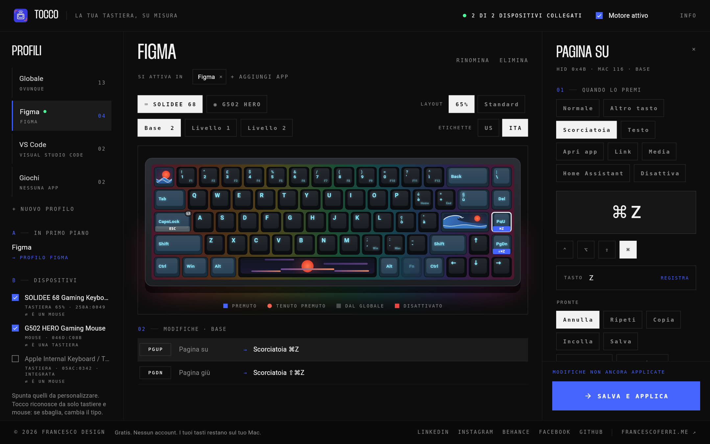
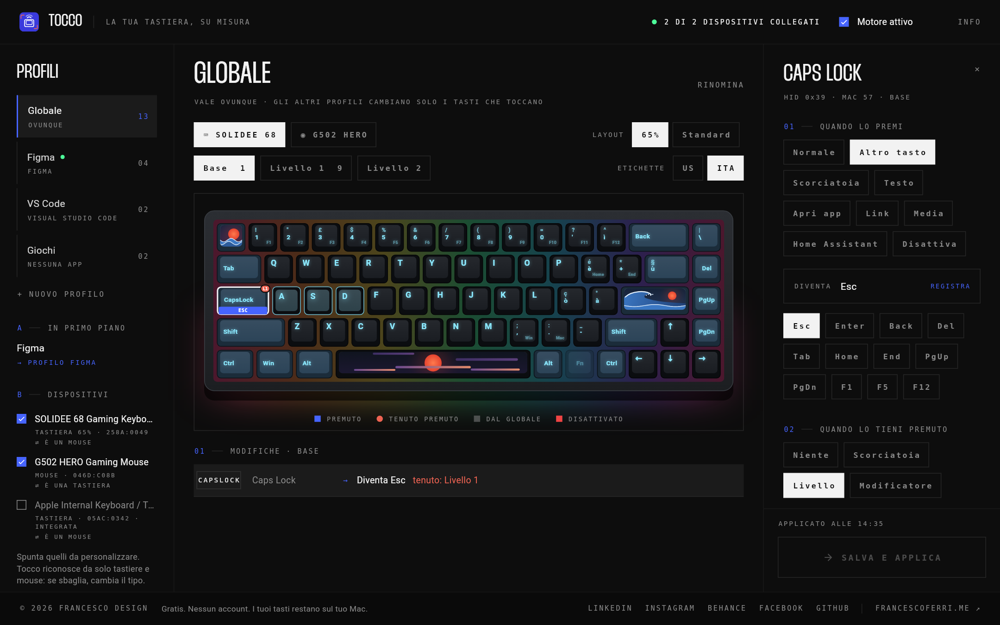
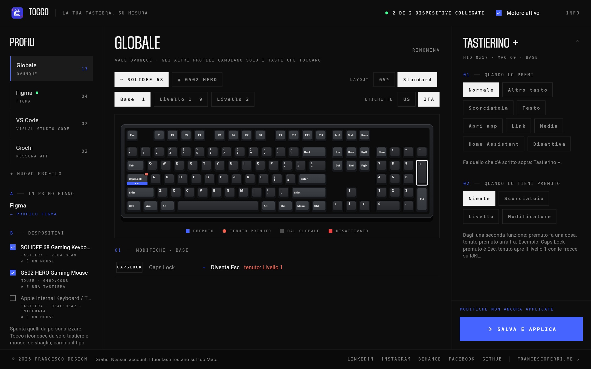
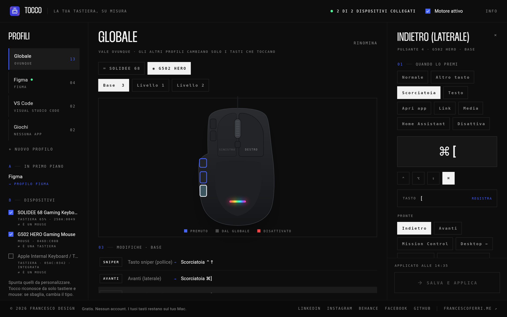
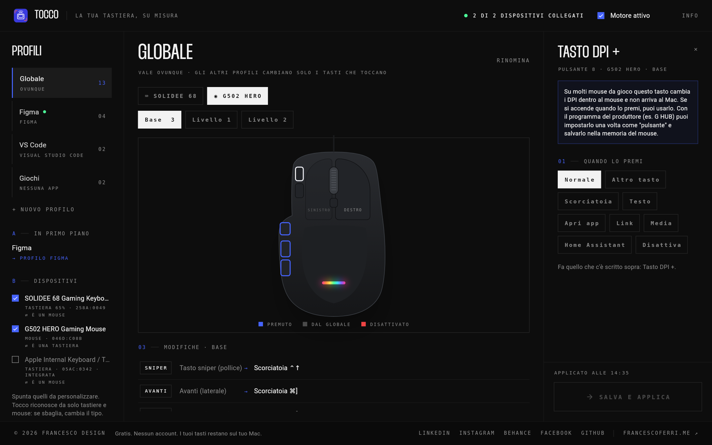

<p align="center">
  
</p>

<h1 align="center">Tocco</h1>
<p align="center"><strong>La tua tastiera, su misura.</strong><br>Personalizza i tasti di tastiere e mouse sul Mac, con profili diversi per ogni app.</p>
<p align="center">Un'app di <a href="https://www.francescoferri.me">Francesco Ferri</a>. Gratis, niente account, tutto resta sul tuo Mac.</p>



## Cosa fa

- **Più tastiere e mouse insieme**: ogni dispositivo ha i suoi tasti, anche se ne colleghi più di uno.
- **Riconosce da solo cosa colleghi**: tastiera o mouse, e che tastiera è.
- **Altro tasto**: Caps Lock diventa Esc, un tasto inutile diventa ⌘Spazio.
- **Scorciatoie**: un tasto o un pulsante del mouse fa ⌘Z, ⌘[ (indietro), Mission Control… La registri premendola.
- **Testo**: un tasto scrive la tua email, una firma, una risposta che usi spesso.
- **Apri app e link**, **tasti multimediali** (play, volume, luminosità), **webhook di Home Assistant**.
- **Tenuto premuto**: lo stesso tasto fa due cose. Per esempio Caps Lock premuto è Esc, tenuto apre un livello con le frecce su IJKL.
- **Tre livelli** per profilo.
- **Profili per app**: Figma, VS Code, giochi… Il profilo cambia da solo quando passi da un'app all'altra. Quello che un profilo non tocca arriva dal profilo Globale.

| Tastiera 65% | Tastiera standard | Mouse |
| --- | --- | --- |
|  |  |  |

## Scaricala

1. Vai su [Releases](../../releases) e scarica `Tocco-macOS.dmg`.
2. Aprilo e trascina Tocco in Applicazioni.
3. **La prima volta** apri Tocco con il tasto destro → **Apri** → **Apri**. L'app non è firmata con un account Apple Developer, quindi macOS chiede conferma una volta sola. Se dice che l'app è danneggiata, lancia nel Terminale:
   ```bash
   xattr -dr com.apple.quarantine /Applications/Tocco.app
   ```
4. Dai i due permessi che chiede, entrambi in **Impostazioni di Sistema → Privacy e sicurezza**:
   - **Accessibilità**, per cambiare i tasti;
   - **Monitoraggio input**, per capire da quale tastiera o mouse arriva un tasto.
5. Chiudi e riapri Tocco. Quando chiudi la finestra, l'app resta nella barra dei menu (icona tastiera): i tasti continuano a funzionare.

Serve macOS 12 o più recente, su Mac con chip Apple o Intel.

## Riconoscimento automatico

All'avvio Tocco chiede a macOS quali tastiere e mouse sono collegati. Per ciascuno legge nome, VendorID e ProductID, e se si presenta come tastiera, come mouse o come entrambi.

**Tastiera o mouse?** Molti mouse da gioco si presentano anche come tastiera (per le macro) e molte tastiere anche come mouse (per manopole e tasti media). Quando c'è il dubbio, decide il nome: "Mouse", "G502", "MX Master", "DeathAdder"… vuol dire mouse.

**Che tastiera?** macOS non dice quanti tasti ha una tastiera, quindi:
- la **SOLIDEE 65%** (68 tasti) viene disegnata con la sua grafica: tasti blu e neri, scritte azzurre, sole rosso e onde;
- **tutte le altre tastiere** usano la **tastiera standard** (ANSI, 104 tasti con tastierino numerico).

Tocco riconosce la SOLIDEE dal nome. Molte tastiere economiche però si presentano con un nome generico, tipo "Gaming Keyboard". In quel caso scegli **SOLIDEE 65%** sopra il disegno, una volta sola: Tocco se la ricorda dal suo VendorID:ProductID.

I ricevitori senza fili che portano tastiera e mouse insieme (Logitech Unifying, Bolt, Lightspeed) diventano due schede: una per la tastiera e una per il mouse.

Tastiere e mouse esterni compaiono da soli come schede sopra il disegno. Si apre quella collegata: a casa la SOLIDEE, al lavoro la tastiera che c'è. Finché non cambi un tasto, un dispositivo resta com'è. Quelli integrati del Mac stanno nella lista a sinistra e li attivi con la spunta. Se Tocco scambia un mouse per una tastiera, lo correggi con **⇄ È un mouse / È una tastiera**. Le modifiche ai tasti restano anche cambiando layout, perché un tasto ha lo stesso nome in entrambi.

### In arrivo
- Scegliere la forma della tastiera (60%, 65%, 75%, TKL, completa, ISO italiana) e partire da un modello standard di quella misura.
- Luci: solo per le tastiere che le fanno comandare dal computer (QMK/VIA e simili). Le altre, come la SOLIDEE, le gestiscono da sole.

## Il mouse



Il mouse disegnato è un mouse da gioco con i tasti laterali, come la serie Logitech G502. Si possono cambiare:

| Pulsante | Di solito | |
| --- | --- | --- |
| Destro | sì | |
| Rotella (click) | sì | |
| Indietro / Avanti (laterali) | sì | i più comodi: ⌘[ e ⌘] sono già pronti |
| Sniper, DPI +, DPI −, tasto dietro la rotella | dipende | vedi sotto |
| Sinistro | no | bloccato apposta, per non restare senza click |

Sui mouse da gioco i tasti DPI e sniper spesso cambiano la sensibilità **dentro al mouse** e non arrivano al Mac. Per sapere se un tasto è utilizzabile, premilo con Tocco aperto: se si accende sul disegno, puoi usarlo. Se non si accende, con il programma del produttore (G HUB per Logitech) assegnagli una volta un "pulsante" e salvalo nella memoria del mouse. Da lì in poi lo gestisce Tocco, anche senza G HUB installato.

La rotella che scorre e i tilt laterali restano come sono.

## Come verificare che funziona

Sotto il disegno c'è **Registro**: ogni volta che Tocco cambia davvero un tasto, compare una riga con ora, tasto, cosa ha fatto, dispositivo, profilo e app. Premi un tasto che hai modificato:
- **compare la riga, ma non succede niente**: Tocco l'ha intercettato e il problema è l'azione (scorciatoia disattivata in macOS, link sbagliato…);
- **non compare niente**: Tocco non l'ha intercettato. Controlla l'avviso rosso sopra il disegno, l'avviso blu "Stai usando…" e il profilo attivo in "In primo piano".

## Limiti da sapere

- **Fn e luci della tastiera** sono gestiti dal firmware della tastiera e non arrivano al Mac.
- Tocco funziona **solo sul Mac**, con l'app attiva. Su un altro computer o su una console tastiera e mouse sono quelli di fabbrica.
- **Riconoscere il dispositivo**: macOS non dice da quale tastiera arriva un tasto, quindi Tocco incrocia ogni tasto con quello che ha visto il driver HID nello stesso istante. Funziona bene, ma serve il permesso Monitoraggio input. Senza quel permesso, le regole valgono per tutti i dispositivi dello stesso tipo.
- La trasformazione vale solo sulla tastiera interessata e quando Tocco si chiude torna tutto com'era. Attenzione: cancella anche eventuali mappature fatte a mano con `hidutil`.
- Nei **campi password** macOS blocca la lettura dei tasti: lì Tocco non cambia niente.
- **Caps Lock e i modificatori di destra** (Shift, Ctrl, Alt, ⌘) si possono cambiare, ma finché Tocco è attivo perdono la loro funzione normale: `hidutil` li trasforma in un tasto F nascosto (F16–F20). Per Shift, Ctrl e così via usa quelli di sinistra, che per ora non si possono cambiare.

## Per sviluppatori

### Costruirla

Serve un Mac con [Flutter](https://docs.flutter.dev/get-started/install/macos) e Xcode.

```bash
git clone https://github.com/Francisff97/keyboard.git
cd keyboard
flutter pub get
flutter run -d macos              # prova in debug
./scripts/build_release.sh        # crea dist/Tocco-<versione>.dmg e .zip
```

In VS Code ci sono già i task (**Terminale → Esegui attività…**):
- **Tocco: avvia in debug**
- **Tocco: crea la versione da scaricare (.dmg)**: è anche il task di build predefinito (⇧⌘B)
- **Tocco: test**
- **Tocco: pubblica una release su GitHub**: crea un tag `vX.Y.Z`, poi GitHub Actions costruisce .dmg e .zip e li allega alla release

**Permessi durante lo sviluppo**: con `flutter run` l'app parte come processo figlio di VS Code o del Terminale, e macOS controlla i permessi di *quelli*, non di Tocco. Per provare davvero i tasti, compila e apri l'app:

```bash
flutter build macos --debug && open build/macos/Build/Products/Debug/Tocco.app
```

C'è anche il task **Tocco: compila e apri l'app**. Ogni ricompilazione cambia la firma dell'app: se i tasti smettono di funzionare, togli Tocco da Accessibilità e Monitoraggio input (−) e rimettilo (+). Se qualcosa manca, Tocco lo dice in rosso sopra il disegno.

### Com'è fatta

```
lib/
  main.dart
  src/
    brand.dart, widgets.dart   stile grafico
    state.dart                 lo stato dell'app
    model/keyboard.dart        i layout: 65%, standard 104, mouse (posizioni, codici HID, keycode Mac)
    model/device.dart          dispositivi e riconoscimento automatico
    model/actions.dart         le azioni (scorciatoia, testo, app…)
    model/profile.dart         profili → dispositivi → livelli → tasti
    data/store.dart            ~/Library/Application Support/Tocco/tocco.json
    engine/engine.dart         ponte verso Swift (canali tocco/engine e tocco/events)
    ui/                        disegno di tastiere e mouse, pannelli, editor
macos/Runner/
  KeyEngine.swift              il motore: IOHIDManager, event tap, hidutil
  AppDelegate.swift            icona nella barra dei menu
```

**Flutter** fa l'interfaccia e salva i profili. **Swift** riceve i profili già tradotti in keycode del Mac (tastiere) e numeri di pulsante (mouse) e:
1. con `IOHIDManager` elenca tastiere e mouse e annota da quale dispositivo arriva ogni pressione;
2. con un event tap (`CGEvent.tapCreate`) intercetta tasti e pulsanti, trova il dispositivo, l'app in primo piano e il livello attivo, e applica l'azione.

Se il motore Swift non risponde, l'interfaccia funziona lo stesso con dati di prova.

### Aggiungere un layout

I layout stanno in `lib/src/model/keyboard.dart`. Un layout è una lista di tasti con posizione (in unità, 1u = un tasto normale), codice HID e keycode del Mac. Per aggiungerne uno (es. TKL, 75%, ISO italiano):
1. crea la lista dei tasti con `_place`, riusando gli id dei tasti esistenti (`esc`, `q`, `caps`…), così le modifiche passano da un layout all'altro;
2. aggiungilo a `Layouts.all` e `Layouts.keyboards`;
3. se vuoi che venga scelto da solo, aggiungi una regola in `Layouts.guess`;
4. lancia `flutter test`: controlla che non ci siano tasti sovrapposti o codici doppi.

## Scorciatoie

| | |
| --- | --- |
| Applica subito (le modifiche si applicano comunque da sole) | `⌘S` |
| Livello Base / 1 / 2 | `⌘1` `⌘2` `⌘3` |

---

Fatta da [Francesco Ferri](https://www.francescoferri.me), designer e sviluppatore web a Todi.
